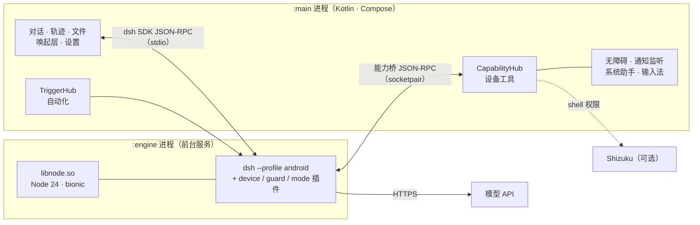

<div align="center">


<br />

**Lazy DSH** · 手机上的 AI 助手，也是能动手执行任务的 Agent

无需 root。读屏、操作 App、整理文件、生成图片、查询课表与考试，还能把答案渲染成可操作的互动场景，把任务交给手机本机运行的 Agent。

在安卓手机上运行 [DeepSeek Harness](https://github.com/deepseek-ai/deepseek-harness)（dsh），
让它操作 App、整理文件、修改系统设置，或者按条件自动执行任务。

[](https://developer.android.com)


</div>

---

## 和 DSH-Android 的关系

项目从 [DSH-Android](https://github.com/jackwener/DSH-Android) 起步。后来包名、品牌、首页、设置、引导、启动流程和能力都做了重做，现在是一个独立项目，不再是可直接合并的分支。DSH-Android 的作者不对本项目的改动负责；原始项目的代码与文档仍是本项目的重要基础，见「致谢」。

## 新版亮点

- **两种模式，两位角色**：电荷 / 叶绿一键切换，调整推理与用量取向，不替换你选定的模型。
- **助手会发表情了**：电荷猫 11 张、叶绿精灵 13 张透明表情，随回复显示；每种模式只向模型提供自己的表情包。
- **后台工作也有回应**：悬浮球显示任务状态，并在工作、等待处理、完成或停止时短暂展示角色反应，无需额外调用模型。
- **弹窗与浮层更新**：菜单、对话框、底部面板、风险确认、图片预览与状态胶囊统一视觉，主要弹层采用不透底的底色，避免下层文字干扰阅读。
- **生图结果直接查看**：独立配置图片接口与模型，凭据保存有反馈，生成结果显示在对话中，原图可保存到相册。
- **课表与考试**：接入济宁医学院教务系统，同步后离线查询今天 / 本周 / 下一节；课表页新增「考试安排」，显示考试日期、时间、校区、教室与座位，考试时长按教务公布的原始时间。
- **对话里的互动场景**：助手可以把答案写成一个可直接在对话中操作的小场景（点击、拖动、滑块），默认内嵌显示，需要时可全屏查看。
- **首页问候看时间和日子**：空首页的标题随节日、星期与周五晚变化，副标题随时段变化，早起与夜猫各有各的文案。
- **更多日常工具**：内置浏览器工具、Office 导出、文件管理和条件自动化。

> 当前源码版本仍为 **0.3.8（versionCode 26）**。本文对应当前工作树，不代表所有改动已经发布到下载页。下方部分截图尚未更新到最新弹层与表情样式。

## 项目特性

| 方向 | 内容 |
|---|---|
| **品牌** | 电荷猫（电荷模式）与叶绿精灵（叶绿模式）、两套配色、启动图标、通知图标、悬浮球与角色表情 |
| **能耗模式** | 输入框上一键切换 电荷 / 叶绿：推理强度、技能目录、任务后自省、系统提示词、配色一起变；**模型始终不变** |
| **冷启动片头** | 2.4 s 逐帧渲染的两版片头（浅色 / 深色），系统 Splash 与首帧同色；只冷启动播一次，可点按跳过；开启「降低动态效果」时退化为静态 `QuietIntro` |
| **内置技能** | 20 个技能随 APK 安装到 `files/dsh-home/skills`，首次启动后出现在 设置 → 扩展 → 技能 |
| **课表与考试** | 济宁医学院教务系统同步；今天 / 本周 / 下一节、考试安排、课前提醒与日历导出，离线可查 |
| **互动场景** | 助手在对话里直接渲染可操作的 HTML 小场景，默认内嵌，可选全屏；运行在无网络、无文件访问的沙箱中 |
| **Office 导出** | 把回复导出成真正的 `.docx` / `.pptx` / `.xlsx`；抽屉里的「文件」页负责打开、分享、删除 |
| **生图** | 设置 → 模型服务 → 生图，接任意 OpenAI 兼容 `/images/generations`；原图进相册 `Pictures/DSH` |
| **账号** | 移除 DeepSeek 账号登录，只保留 API Key（Keystore 加密存本机） |
| **更新** | 移除 App 内更新检查；换版本时自行下载覆盖安装 |
| **包名** | `io.github.lazy.dsh`，可与 DSH-Android 原版同时安装 |

<div align="center">


<sub>电荷模式 · 叶绿模式 · 能耗模式设置</sub>

</div>

## 界面一览

<div align="center">


<sub>会话抽屉 · 设置 · 首次启动（只需要一个 API Key）</sub>

</div>

## 快速开始

1. 安装 APK：自己构建的产物在 `app/build/outputs/apk/debug/app-debug.apk`；如果发布页有包，也可以直接下载。
2. 首次启动填入 [DeepSeek API Key](https://platform.deepseek.com/api_keys)。Key 用 Android Keystore 加密后存本机；也可以在 设置 → 模型服务 里改用其他 OpenAI 兼容服务商。
3. 直接说要做什么，例如「列出下载目录里最大的 5 个文件」「把这条消息回一下」「明早 7:30 叫我」。
4. 用到某项权限时 App 会再引导开启；不需要一次给全。
5. 可选：在 设置 → 手机权限 里一键安装 Shizuku，解锁后台屏、系统开关等更多能力。

> Lazy DSH 的包名是 `io.github.lazy.dsh`，与原版不同，可以并存安装，但不会自动迁移数据。同包名、同签名的 Lazy DSH 版本可覆盖升级；同包名但签名不同不能直接覆盖。卸载会清除 App 私有数据，请先导出需要保留的内容。

## 能做什么

- **文件**：查找、整理、移动、重命名、压缩解压；能读 PDF / Word / Excel / PPT 里的文字。
- **屏幕和 App**：读屏、点击、滑动、输入（基于无障碍服务）；打开 App 或直接跳到指定页面。配好 Shizuku 后可在独立的后台屏操作（Android 11+），你继续用主屏。
- **系统设置**：亮度、音量、勿扰、闹钟、Wi‑Fi、蓝牙、定位；读取和回复通知，控制媒体播放。
- **生图**：填一个 OpenAI 兼容的生图接口，助手就能按描述画图；原图进相册 `Pictures/DSH`，对话里直接显示。
- **Office 导出**：回复下方「导出」→ Word / PPT / Excel，抽屉 → 文件 里统一管理。
- **内置浏览器**：通过 App 内的 WebView 打开网页、读取文字和交互元素、点击、输入、滚动与截图；不依赖电脑浏览器，也不共享其他浏览器的登录状态。
- **课表与考试**：已接入济宁医学院教务系统，同步后可离线查询今天 / 本周 / 下一节、查看考试安排（时间、校区、教室、座位）、配置课前提醒与导出日历；目前不是通用高校课表接口。
- **互动场景**：助手可以把答案渲染成一个可在对话里直接操作的小页面（点击、拖动、滑块），默认内嵌，需要时可全屏查看。
- **自动化**：定时执行，或在连上 Wi‑Fi / 蓝牙、开始充电、到达某地、收到通知等条件下触发。
- **扩展**：技能、MCP 服务、第三方插件都能装；内置 20 个技能开箱可用。
- **多模型**：除 DeepSeek 外，也可配置其他服务商的 OpenAI 兼容 Chat Completions 接口；模型、工具调用和推理参数是否可用，取决于服务端兼容性。服务商预设不代表支持其所有原生 API。
- **随时呼起**：悬浮球、快捷设置磁贴、分享菜单、系统助手都能把当前这一屏交给它。
- **完整的 dsh**：dsh 原样运行（没有 fork），技能、MCP、子 agent、网页搜索都能用。

## 能耗模式：电荷 / 叶绿

同一个模型，两种花法。开关在输入框控制行最前面，也可以在 设置 → 通用 → 能耗模式 里选。

| | 电荷 Electric | 叶绿 Leaf |
|---|---|---|
| 模型 | **不变** | **不变** |
| DeepSeek 推理强度 | High | Low |
| 提示词里的技能目录 | 保留 | 不发送 |
| 设备任务后的经验总结 | 开 | 关，不额外调用模型 |
| 回答取向 | 一次决定、批量调用工具、把事情办完 | 最短正确回答、复用上下文、跳过可选步骤 |
| 角色与视觉 | 电荷猫：电蓝紫 + 闪电金 | 叶绿精灵：叶绿配色 |
| 回复表情 | 电荷猫的 11 张表情 | 叶绿精灵的 13 张表情 |

切换模式不会替换所选模型，但会影响推理参数、上下文开销与额外调用，因此实际费用可能变化。「能耗」指模型使用策略，不是系统省电模式，也不保证固定的省电或降费比例。第三方模型按其支持的推理档位适配。实现细节见 [能耗模式](docs/ENERGY-MODES.md)。

## 角色表情与后台陪伴

### 由助手发送的表情

助手可以在问候、完成任务、安慰或轻松交流时，在文字回复后附上一张当前模式的表情。是否使用取决于模型，不保证每条回复都会出现。

- 电荷模式使用电荷猫，叶绿模式使用叶绿精灵；切换模式不影响历史消息中已有表情的显示。
- 表情为本地透明 PNG，不需要临时生成图片，也不调用生图接口。
- 在 **设置 → 通用 → 更多 → 表情包** 查看两套图集；点开后可预览、保存到相册或通过系统分享面板分享。
- 图集用于浏览、保存和分享，不是用户在输入框里发送表情的面板。保存与分享保留原始 PNG 及透明通道。

### 退到后台，也知道它在做什么

悬浮球配合状态胶囊展示任务进展，角色反应出现在小球上方，每次约 **2.8 秒**；持续工作期间约每 **20 秒** 再展示一次。

反应由本地任务状态驱动，与聊天中模型选择的表情独立，跟随现有状态显示开关。代码对 App 前台、拖动、通知提示和应用内截图等场景做了隐藏处理；浮层表现仍可能受 Android 版本及厂商 ROM 影响。

## 生图、文档与课表

### 生成图片

1. 打开 **设置 → 模型服务 → 生图**，启用并配置接口地址、API Key、图片模型和尺寸。
2. 接口需兼容 OpenAI 的 `/images/generations`；聊天模型与图片模型分别配置。
3. 在对话中描述图片，例如「画一张薄荷绿配色的猫咪手机壁纸」。
4. 生成结果在对话中展示，可打开预览；保存成功时，原图位于相册的 `Pictures/DSH`。

具体尺寸、数量和返回格式取决于服务商，并非所有 OpenAI 兼容接口都支持生图。图片生成可能单独计费；本地角色表情不走这个接口。

### 导出 Office 文件

回复下方 **导出 → Word / PPT / Excel**，生成真正的 `.docx` / `.pptx` / `.xlsx`，通过 **抽屉 → 文件** 打开、分享或删除结果。

### 查询课程与考试

济宁医学院课表首次同步需要内置浏览器中有效的教务登录会话。同步后可从本地缓存查询课程，并配置课前提醒或导出日历。验证码需要用户参与；教务系统变更可能导致同步失效。

课表页分为「课程」和「考试安排」两个标签。考试安排从教务系统单独同步，包含考试日期、开始时间、校区、教室与座位；考试时长按教务公布的原始时间显示，不受上课作息影响，座位未公布时会明确标注。同步课程时会顺带刷新考试安排，考试同步失败不会影响已保存的课程；两边的状态都可以在课表页看到。

## 对话里的互动场景

助手有时会把答案写成一个可以直接上手的小场景，而不是一段文字：一副能点开的图、一块能按的棋盘、一个能拖动的滑块。这类场景就渲染在对话里，按钮、拖动和脚本都能用，不用离开聊天。

- 场景是一份自带样式与脚本的完整网页，内嵌在回复中，默认高度约 360 dp，随卡片宽度自适应。
- 右上角的 **全屏查看** 打开独立窗口（也可以让助手在生成时直接全屏）；返回对话后，内嵌场景仍然保留。
- 场景运行在受限沙箱里：没有网络、没有文件访问，也没有桥接到 App 的接口，页面不能跳转到外部地址。
- 场景由模型按需生成，是否出现取决于回答内容；保存的场景以 HTML 文件存放在 App 私有目录。

实现细节见 [互动窗口](docs/INTERACTIVE.md)。

## 权限与数据

按任务开启权限即可，不必一次全部授予：

| 能力 | 相关权限或条件 |
|---|---|
| 读屏、点击、滑动和输入 | 无障碍服务；部分能力依赖 Android 版本或可选 Shizuku |
| 读取通知、通过通知快捷回复 | 通知使用权，且目标通知提供相应操作 |
| 悬浮球、状态胶囊与角色反应 | 悬浮窗权限；部分 ROM 还需允许后台弹出界面 |
| 自动化、课程提醒 | 按规则需要通知、定位、闹钟或后台运行条件 |
| 后台屏与更多系统操作 | 可选 Shizuku；后台屏要求 Android 11+ |

API Key 用 Android Keystore 加密后保存在本机。会话与附件等数据位于 App 私有目录；调用远程模型时，请求中的对话、工具结果或图片会发送给所选服务商，并非全程离线。保存到相册或分享到外部的文件不再只属于 App 私有数据，卸载不会自动清理所有外部副本。

## 冷启动片头

<div align="center">

</div>

- 正片是两段 1080×2372 / 60 fps / 2.4 s 的 H.264 视频：`res/raw/splash.mp4`（浅色）与 `splash_dark.mp4`（深色）。
- 系统 Splash 的背景色与片头第一帧一致（浅色 `#D1E6C6`，深色 `#0B0C10`），冷启动不跳色。
- 片头是盖在已经组合好的首页之上的 overlay：引擎启动、首页布局都不等它，也不会被任何页面盖住。
- 只在冷启动播放；旋转、切主题、从最近任务回来都不重播；点一下可以立刻跳过。
- 开启系统「移除动画 / 降低动态效果」时播放静态 `QuietIntro`（上图），只留光环慢转和 900 ms 淡出。

时间轴、调色和重新渲染方法见 [冷启动片头](docs/LAUNCH-INTRO.md)；片头工程在仓库外的 `../GIF/dsh-splash/`。

## 架构



- **引擎嵌在 App 里**：Node 24 编译成安卓原生共享库，通过 JNI 在 `:engine` 前台服务里启动。不用 proot、不用 Termux。
- **dsh 不做 fork**：App 只通过 dsh 的 SDK 协议和它对话；安卓适配放在插件和少量构建期补丁里（见 [js/README.md](js/README.md)）。
- **手机能力在 App 侧**：设备工具全部由 Kotlin 实现，通过一条私有 socket 暴露给 dsh（见 [引擎契约](docs/ENGINE-CONTRACT.md)）。
- **数据在本机**：会话、附件、App 经验、导出的 Office 文件都在 App 私有目录；`allowBackup=false`，卸载即清除。

## 系统要求

- Android 10 及以上（minSdk 29），arm64-v8a。
- 调试包约 123 MB；建议预留 500 MB 可用空间。
- 需要能访问所选模型服务的 API；联网搜索由 DeepSeek 提供，用第三方模型时需要另配 DeepSeek API Key。

## 安装失败怎么办

- **「与已安装应用签名不一致」**：同包名应用的签名不同，不能直接覆盖。优先使用相同签名的安装包；必须卸载时请先导出数据。原版与Lazy DSH包名不同，可并存安装。
- **「解析失败 / 解析包出现问题」**：多半是没下完整，或经微信、QQ 转发后被改名（例如变成 `.apk.1`）。重新下载并核对 SHA-256。
- **「不兼容 / 与设备不兼容」**：只支持 Android 10 及以上的 arm64-v8a 手机；x86 模拟器装不上。
- **提示安装风险或被系统拦截**：先核对来源、签名及校验值，再确认具体拦截原因；不要为安装来历不明的APK关闭系统安全检查。

## 当前限制

- **锁屏后不能操作其他 App**：有安全锁屏时，系统不允许操作其他 App 的界面。这类任务会暂停并提示解锁；文件、设置、通知等系统 API 任务照常执行。
- **Shizuku 重启后要重新启动**：建议打开 Shizuku 的「开机启动（无线调试）」（Shizuku 13.6+、Android 11+）。
- **国产 ROM**：部分机型需要手动允许「后台弹出界面」和「自启动」，悬浮球和后台自动化才能稳定工作；App 的体检页会提示。
- **第三方模型**：只支持 OpenAI 兼容的 Chat Completions 接口（HTTPS）；上下文统一按 128K 计；推理强度只对引擎认得的模型家族列出支持的档位。工具调用效果取决于所选模型。
- **课表与考试需要登录**：只接入济宁医学院教务系统，且依赖内置浏览器里有效的教务登录会话；会话过期后需要重新登录才能同步。
- **引擎冷启动**：启动时间依设备和运行环境而异；片头不代表引擎已经就绪。
- **片头只有冷启动**：MP4 没有 alpha 通道，背景必须是实色，所以是整屏 overlay，不能叠在任意界面上。
- **内置技能授权**：20 个技能里，7 个为项目作者原创，5 个在 frontmatter 声明 MIT，另外 8 个通用技能未声明许可证。公开分发前需要逐个确认上游许可证，或从 `assets/skills/` 移除；详见 [BUNDLED-SKILLS.md](docs/BUNDLED-SKILLS.md)。

## 开发者

<details>
<summary><b>从源码构建</b></summary>

需要 JDK 21、Android SDK（compileSdk 37.2）、NDK r29；引擎和原生库还需要 Node/npm、`patch`、`python3`。在 arm64 Linux 主机上构建时要额外传入 `-Pandroid.aapt2FromMavenOverride=<arm64 版 aapt2 的路径>`。

```bash
# 1. 原生库（libnode 等）：下载预编译产物并校验哈希，不用自己编 Node
native/prebuilt.sh fetch            # → toolchains/out/jniLibs/arm64-v8a/

# 2. 引擎包：dsh + 插件 + 补丁 → engine.zip
OUT_DIR=toolchains/out/engine js/build-engine.sh

# 3. APK
./gradlew :app:assembleDebug -Pdsh.engineOut="$PWD/toolchains/out/engine"
```

Windows 上引擎构建走 WSL，本工作区封装在 `F:\DSH\toolchains\build-engine.sh`：

```powershell
wsl bash /mnt/f/DSH/toolchains/build-engine.sh
.\gradlew.bat :app:assembleDebug -Pdsh.fetchShizuku=false
```

- 预编译产物的标签由 Node 版本加全部原生补丁的哈希生成（例如 `native-node24.22.1-caacecde44`）。只有升级 Node 或改动原生补丁时才需要重编：先运行 `native/build.sh`，再用 `native/prebuilt.sh publish` 发布。
- `toolchains/`、`local.properties`、构建日志都在 `.gitignore` 里，不参与提交。
- 主机端到端测试（真实调用 DeepSeek API）：`node js/test/host-e2e.mjs`，API Key 放在 `DSH_E2E_KEY_FILE` 指向的文件里。

</details>

<details>
<summary><b>测试与截图（不需要真机）</b></summary>

```powershell
# 单元测试 + Roborazzi 截图；截图输出到 app/build/screenshots/
.\gradlew.bat :app:testDebugUnitTest -I F:\DSH\toolchains\dev.init.gradle
```

截图覆盖首页、抽屉、设置、引导、能耗模式页、QuietIntro和Markdown表格。测试数量以当前Gradle报告为准。

2026-11-08本地回归：单元测试和APK构建通过，修正版已覆盖安装到真机。已实测两种模式的聊天表情、图集、预览、透明PNG保存和系统分享面板；已捕获后台工作期间的周期反应。点击穿透、边缘拖动、应用内截图隐藏及状态开关组合尚未完整真机回归，不代表全部新增功能均已全面验证。

`dev.init.gradle` 只是本机辅助：加阿里云 Maven 镜像，并把 Roborazzi 设成录制模式。在普通环境里去掉 `-I` 参数即可。

</details>

<details>
<summary><b>目录结构</b></summary>

```text
app/        Android App（Kotlin · Compose · Hilt · Room）
  core/designsystem/  设计令牌、品牌、字体、动效、玻璃效果
  core/office/        Word / PPT / Excel 写入（ZIP + OOXML，纯 Kotlin）
  core/skills/        内置技能播种
  core/engine/        引擎进程、JNI 启动、崩溃恢复
  core/capability/    设备工具（文件、屏幕、系统、通知、媒体……）
  core/timetable/     济宁医学院课表与考试缓存、同步与提醒
  core/interactive/   互动场景沙箱与视口处理
  core/greeting/      首页问候的日期与时段选择
  core/trigger/       自动化规则和事件源
  feature/            对话、轨迹、文件、设置、片头、语音、扩展、课表、互动窗口
  res/raw/            冷启动片头（splash.mp4 / splash_dark.mp4）
  assets/skills/      随 APK 安装的 20 个技能
js/         dsh 的 android profile、插件、补丁，build-engine.sh → engine.zip
native/     Node 24 安卓构建、JNI 包装、原生插件、预编译产物脚本
tools/      字符串、图标、README 首图等生成脚本
docs/       架构、引擎契约、设计 token、品牌、片头、Office 导出、课表、互动窗口、首页问候
```

</details>

<details>
<summary><b>翻译 / 添加界面语言</b></summary>

`app/src/main/res/values/` 是中文（默认），`values-en/` 是英文，`values-ru/` 是俄语。添加一种语言只需两步：

1. 新建 `app/src/main/res/values-<语言代码>/`，复制 `values-en/` 下的全部 `strings*.xml` 并翻译（lint 的 MissingTranslation 会报漏翻的条目）；
2. 在 `app/src/main/res/xml/locales_config.xml` 里加一行 `<locale android:name="<语言代码>" />`。

设置 → 通用 → 语言 的选项和 Android 13+ 系统设置里的「应用语言」都读这份列表，不用改代码；单元测试 `LocalesConfigTest` 会检查两者一致。引擎拿到的语言（`DSH_ANDROID_LOCALE`）跟随 App 语言。

</details>

<details>
<summary><b>设计文档</b></summary>

- [架构](docs/ARCHITECTURE.md)
- [引擎契约（App ↔ dsh）](docs/ENGINE-CONTRACT.md)
- [插件契约](docs/PLUGINS-CONTRACT.md)
- [设计 token](docs/design-tokens.md)
- [品牌素材](docs/BRAND-ASSETS.md)
- [能耗模式](docs/ENERGY-MODES.md)
- [冷启动片头](docs/LAUNCH-INTRO.md)
- [内置技能](docs/BUNDLED-SKILLS.md)
- [Office 导出](docs/OFFICE-EXPORT.md)
- [课表与考试](docs/TIMETABLE.md)
- [互动窗口](docs/INTERACTIVE.md)
- [首页问候](docs/GREETING.md)
- [后台屏操作设计稿](docs/AGENT-SCREEN-V2.md)
- [工具结果卡片设计稿](docs/RESULT-CARDS.md)
- [发布流程](docs/RELEASE.md)

</details>

## 致谢

- [DSH-Android](https://github.com/jackwener/DSH-Android)：本项目的起点
- [DeepSeek Harness](https://github.com/deepseek-ai/deepseek-harness)：agent 引擎
- [Node.js](https://nodejs.org)；安卓构建参考了 [Termux](https://github.com/termux/termux-packages) 和 [nodejs-mobile](https://github.com/nodejs-mobile/nodejs-mobile) 的做法
- [Shizuku](https://github.com/RikkaApps/Shizuku)（Apache-2.0）：App 内置了官方安装包
- [ripgrep](https://github.com/BurntSushi/ripgrep)
- [dsh-llm-service-lite](https://github.com/snnh/dsh-llm-service-lite)（MIT，snnh）：第三方模型适配器，原样内置于 `js/packages/llm-service-lite/`
- [magpie](https://github.com/yetone/magpie)（MIT）：服务商预设地址和接入 dsh 的经验

## 声明

本项目是社区项目，与 DeepSeek 官方无关联，也未获其背书。项目从 `jackwener/DSH-Android` 起步，之后做了大量重做，现独立维护；DSH-Android 的作者不对本项目的改动负责。「DeepSeek」及相关商标归其各自所有者所有。

## 许可证

[Apache License 2.0](LICENSE)。内置的第三方组件（Node.js、dsh、dsh-llm-service-lite、Shizuku、ripgrep 等）遵循各自的许可证。
